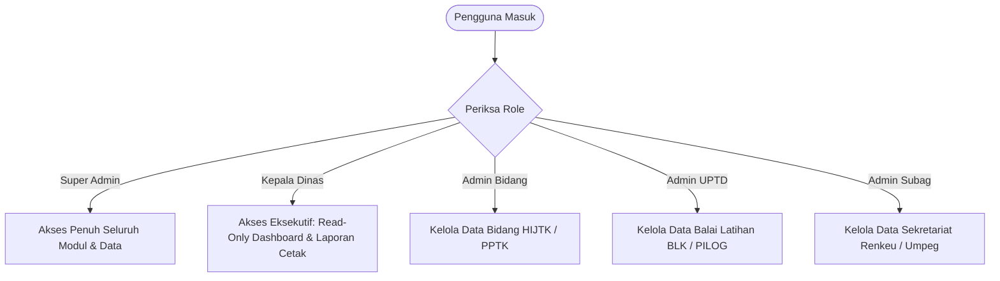
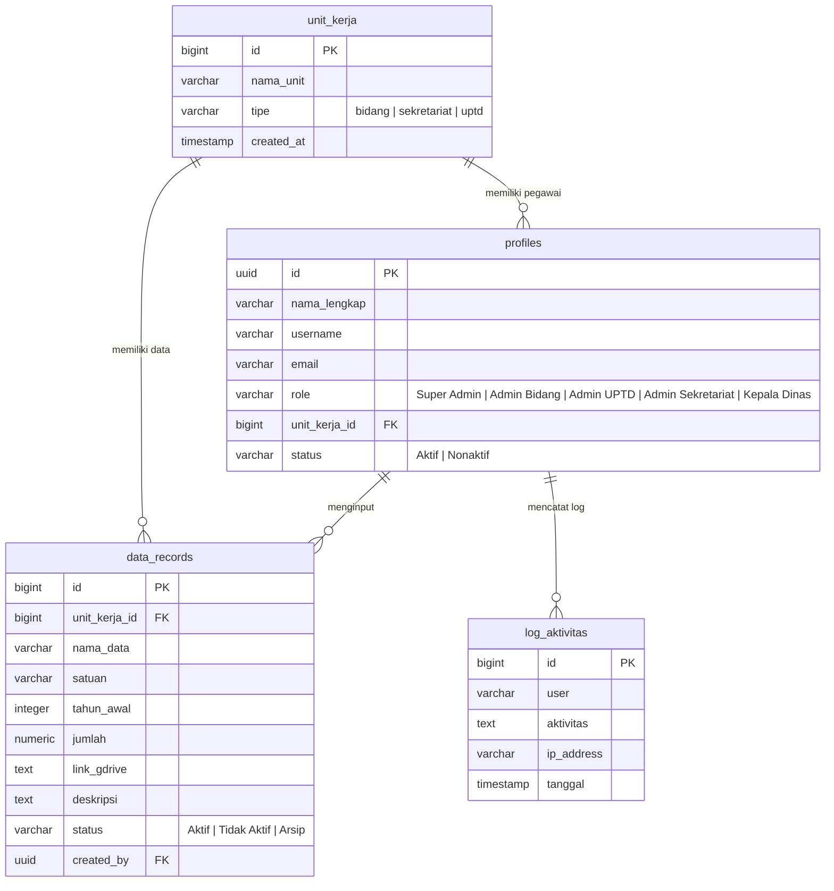

# 📘 DOKUMENTASI LENGKAP SISTEM INFORMASI SATU DATA
### Dinas Perindustrian dan Tenaga Kerja (DINPERINNAKER) Kabupaten Purbalingga

---

## 📑 DAFTAR ISI
1. [Ringkasan & Profil Proyek](#1-ringkasan--profil-proyek)
2. [Latar Belakang & Tujuan](#2-latar-belakang--tujuan)
3. [Arsitektur & Spesifikasi Teknologi](#3-arsitektur--spesifikasi-teknologi)
4. [Struktur Folder & Navigasi Halaman](#4-struktur-folder--navigasi-halaman)
5. [Hak Akses Pengguna (Role-Based Access Control / RBAC)](#5-hak-akses-pengguna-role-based-access-control--rbac)
6. [Struktur Basis Data (Database Schema)](#6-struktur-basis-data-database-schema)
7. [Fitur-Fitur Utama Sistem](#7-fitur-fitur-utama-sistem)
8. [Panduan Instalasi & Menjalankan Proyek](#8-panduan-instalasi--menjalankan-proyek)
9. [Catatan Penting Pemeliharaan & Troubleshooting](#9-catatan-penting-pemeliharaan--troubleshooting)

---

## 1. 🏢 Ringkasan & Profil Proyek

* **Nama Aplikasi**: Sistem Informasi Satu Data DINPERINNAKER
* **Instansi**: Dinas Perindustrian dan Tenaga Kerja Kabupaten Purbalingga, Provinsi Jawa Tengah
* **Tipe Aplikasi**: Portal Data Statistik Sektoral & Pelaporan Kinerja Berbasis Web
* **Pengembang**: Tim Magang / Pengembang Sistem Satu Data DINPERINNAKER
* **Versi Sistem**: 2.0 (Next.js 16 + Supabase PostgreSQL)

Aplikasi ini menyatukan seluruh data statistik sektoral perindustrian dan ketenagakerjaan dari seluruh unit kerja operasional dinas ke dalam satu platform terpusat, akuntabel, dan siap cetak sesuai tata naskah dinas resmi.

---

## 2. 🎯 Latar Belakang & Tujuan

### A. Latar Belakang
Sebelum sistem ini diimplementasikan, pendataan pada masing-masing bidang, sekretariat, dan balai/UPTD masih tersebar di lembar kerja spreadsheet (Excel) masing-masing staf. Hal ini menyebabkan:
* Kesulitan konsolidasi data kinerja tahunan secara cepat dan akurat.
* Potensi redudansi dan inkonsistensi versi data.
* Keterlambatan dalam penyusunan laporan evaluasi untuk pimpinan/Kepala Dinas.
* Bukti dukung fisik dokumen seringkali tercecer.

### B. Tujuan Sistem
1. **Sentralisasi Data**: Menghimpun seluruh data statistik sektoral industri dan ketenagakerjaan Purbalingga dalam satu basis data terstandar.
2. **Efisiensi Pelaporan**: Memangkas waktu penyusunan laporan triwulanan dan tahunan menjadi hitungan detik dengan cetak otomatis ber-Kop Surat resmi Pemkab Purbalingga.
3. **Akuntabilitas & Arsip Digital**: Mengintegrasikan setiap poin data dengan tautan berkas pendukung di Google Drive secara aman.
4. **Isolasi Data yang Adil**: Memastikan tiap unit kerja mengelola datanya masing-masing dengan sistem peran (RBAC) yang ketat.

---

## 3. 🛠️ Arsitektur & Spesifikasi Teknologi

Sistem dibangun menggunakan ekosistem JavaScript/TypeScript modern dengan performa tinggi dan arsitektur serverless/cloud.

```
┌────────────────────────────────────────────────────────┐
│                   CLIENT (BROWSER)                     │
│  Next.js 16 (App Router) + React 19 + Tailwind CSS v4 │
│  Lucide Icons + Framer Motion + Chart.js + SheetJS     │
└───────────────────────────┬────────────────────────────┘
                            │ HTTPS / API Client
┌───────────────────────────▼────────────────────────────┐
│              NEXT.JS FULLSTACK ENVIRONMENT             │
│  - Turbopack Engine                                    │
│  - DataContext & ThemeContext (State Management)       │
│  - Client-Side Role-Based Route Guards                 │
│  - Print & Export Engine (Kop Surat & Excel .xlsx)     │
└───────────────────────────┬────────────────────────────┘
                            │ Supabase JS SDK (PostgreSQL)
┌───────────────────────────▼────────────────────────────┐
│                DATABASE TIER (SUPABASE)                │
│            Cloud Serverless PostgreSQL                 │
│  (unit_kerja, profiles, data_records, log_aktivitas)   │
└────────────────────────────────────────────────────────┘
```

### Tabel Spesifikasi Teknologi:
| Komponen | Teknologi | Keterangan |
| :--- | :--- | :--- |
| **Framework Frontend & Server** | Next.js 16.4.2 (Turbopack) | App Router, Server/Client Components |
| **Library UI Utama** | React 19.3.0 | Komponen reaktif, hook memoized |
| **Bahasa Pemrograman** | TypeScript 5 | Type-safety penuh pada entitas dan model data |
| **Styling & Desain** | Tailwind CSS v4 | Mendukung Dual Theme (Light Mode & Dark Mode) |
| **Basis Data** | Supabase (PostgreSQL Cloud) | Penyimpanan cloud terkelola dengan Row-Level Security |
| **Ikonografi** | Lucide React | Ikon modern, tajam, dan ringan |
| **Animasi** | Framer Motion & Canvas Confetti | Transisi modal, dropdown, dan kartu interaktif |
| **Grafik & Visualisasi** | Chart.js & React-Chartjs-2 | Grafik batang dan lingkaran statistik sektoral |
| **Ekspor Data** | SheetJS (XLSX) | Ekspor rekapitulasi data ke format Excel (.xlsx) |

---

## 4. 📁 Struktur Folder & Navigasi Halaman

### A. Struktur Direktori Proyek
```text
satudata-nextjs/
├── public/                 # Berkas statis (logo-purbalingga.png, favicon, dll.)
├── src/
│   ├── app/                # Halaman & Rute Aplikasi (App Router)
│   │   ├── layout.tsx      # Root layout & penyedia konteks global
│   │   ├── page.tsx        # Halaman Dashboard Utama (/)
│   │   ├── globals.css     # Styling global & token Tailwind v4
│   │   ├── login/          # Halaman Otentikasi (/login)
│   │   ├── kelola-data/    # Modul CRUD Data Sektoral (/kelola-data)
│   │   ├── laporan/        # Modul Filter & Rekapitulasi Laporan (/laporan)
│   │   │   └── print/      # Template Cetak Resmi Kop Surat (/laporan/print)
│   │   ├── unit-kerja/     # Manajemen Master Unit Kerja (/unit-kerja)
│   │   ├── users/          # Manajemen Pengguna & RBAC (/users)
│   │   └── backup/         # Modul Backup SQL, Ekspor JSON & Audit Log (/backup)
│   ├── components/         # Komponen Modular Reusable
│   │   ├── layout/         # Layout master (AppLayout, Sidebar, Topbar, Notifikasi)
│   │   ├── data/           # Komponen data table & modal
│   │   └── ui/             # Tombol, badge, input form
│   ├── context/            # Global State Management
│   │   ├── DataContext.tsx # Sentralisasi logika CRUD, data mock & Supabase sync
│   │   ├── ThemeContext.tsx# Logika toggle Light/Dark Mode
│   │   └── LoadingContext.tsx # Indikator loading navigasi
│   ├── lib/                # Konfigurasi Supabase & utility helper
│   │   └── supabase.ts     # Client Supabase
│   └── types/              # Definisi interface TypeScript (UnitKerja, User, DataRecord)
├── supabase_schema.sql     # Skrip DDL & DML skema database PostgreSQL
├── package.json            # Daftar dependensi & scripts NPM
└── next.config.ts          # Konfigurasi Next.js
```

### B. Pemetaan Rute Antarmuka
| Rute URL | Nama Modul | Deskripsi & Fungsi |
| :--- | :--- | :--- |
| `/login` | **Login Portal** | Masuk ke sistem dengan akun atau Quick Demo Selector untuk 5 peran. |
| `/` | **Dashboard** | Statistik total data, unit kerja, persentase bukti Google Drive, dan grafik distribusi sektoral. |
| `/kelola-data` | **Kelola Data** | Form penambahan, pengeditan, penghapusan data sektoral, serta impor/ekspor data. |
| `/laporan` | **Laporan** | Filter data multi-parameter (Unit, Tahun, Status, Rentang Tanggal) & tombol cetak/ekspor. |
| `/laporan/print` | **Cetak Dokumen** | Lembar cetak ber-Kop Surat resmi Pemkab Purbalingga siap print/simpan ke PDF. |
| `/unit-kerja` | **Master Unit Kerja** | Pengelolaan master bidang, sekretariat, dan balai dinas (*Khusus Super Admin*). |
| `/users` | **Manajemen Pengguna** | Pengelolaan akun staf dinas, role, dan status aktif/nonaktif (*Khusus Super Admin*). |
| `/backup` | **Backup & Pemeliharaan** | Ekspor SQL backup, download JSON, dan pemantauan riwayat log aktivitas (*Khusus Super Admin*). |

---

## 5. 👥 Hak Akses Pengguna (Role-Based Access Control / RBAC)

Sistem membagi wewenang ke dalam **5 Tingkatan Peran Pengguna**:



### Matriks Wewenang:
| Aksi / Modul | Super Admin | Admin Bidang | Admin UPTD | Admin Subag | Kepala Dinas |
| :--- | :---: | :---: | :---: | :---: | :---: |
| **Login Sistem** | ✅ | ✅ | ✅ | ✅ | ✅ |
| **Melihat Dashboard Agregat** | ✅ | ✅ | ✅ | ✅ | ✅ |
| **Melihat Data Unit Lain** | ✅ | ✅ (Read) | ✅ (Read) | ✅ (Read) | ✅ (Read) |
| **Tambah Data Sektoral** | ✅ (Semua Unit) | ✅ (Unit Sendiri) | ✅ (Unit Sendiri) | ✅ (Unit Sendiri) | ❌ |
| **Ubah / Hapus Data** | ✅ (Semua Data) | ✅ (Hanya Miliknya)| ✅ (Hanya Miliknya)| ✅ (Hanya Miliknya)| ❌ |
| **Kunci Form Unit Otomatis** | ❌ (Bebas pilih) | ✅ (Terkunci) | ✅ (Terkunci) | ✅ (Terkunci) | — |
| **Cetak Laporan Kop Surat** | ✅ | ✅ | ✅ | ✅ | ✅ (Fitur Utama) |
| **Ekspor Rekap Excel (.xlsx)**| ✅ | ✅ | ✅ | ✅ | ✅ |
| **Kelola Master Unit Kerja** | ✅ | ❌ | ❌ | ❌ | ❌ |
| **Kelola Pengguna & Akun** | ✅ | ❌ | ❌ | ❌ | ❌ |
| **Pencadangan Database & Log**| ✅ | ❌ | ❌ | ❌ | ❌ |

---

## 6. 🗄️ Struktur Basis Data (Database Schema)

Sistem menggunakan database relasional PostgreSQL (Supabase) dengan 4 entitas utama:



---

## 7. 🚀 Fitur-Fitur Utama Sistem

1. **Dashboard Interaktif & Realtime Metrik**:
   - Menghitung otomatis total data sektoral, jumlah unit kerja aktif, jumlah pengguna terdaftar, dan kelengkapan bukti dukung Google Drive.
   - Grafik batang visualisasi perbandingan data antar-bidang dan UPTD.
   - Filter cepat berdasarkan tahun data (2024, 2025, 2026, atau Seluruh Tahun).

2. **Pengelolaan Data Sektoral & Validasi Otomatis**:
   - Pencarian instan (*realtime search*) berdasarkan nama indikator data atau satuan.
   - Indikator status kepemilikan data (*Badge Owner*: "Milik Unit Anda" vs "Milik Unit Lain").
   - Penguncian dropdown unit kerja saat staf bidang menginput data baru agar tidak salah sasaran.
   - Validasi URL Google Drive dengan tombol uji buka tautan langsung.

3. **Generator Laporan Ber-Kop Surat Resmi**:
   - Menghasilkan format dokumen formal berstandar Pemerintah Kabupaten Purbalingga lengkap dengan logo daerah, garis kop surat ganda, tabel ringkasan, dan kolom tanda tangan Kepala Dinas.
   - Siap cetak fisik (kertas A4/Folio) atau simpan sebagai dokumen PDF melalui dialog cetak browser.
   - Ekspor tabel ke file spreadsheet Microsoft Excel (`.xlsx`) lengkap dengan metadata.

4. **Desain Dual Tema (Light Mode & Dark Mode)**:
   - Dukungan mode gelap (*Dark Mode*) modern untuk kenyamanan mata saat bekerja di malam hari.
   - State tema disimpan di `localStorage` dan tersinkronisasi instan di seluruh komponen.

5. **Notifikasi Interaktif & Log Audit Trail**:
   - Pusat notifikasi di bilah atas (*Topbar*) yang memantau perubahan data terbaru.
   - Pencatatan aktivitas (*Audit Trail*) untuk setiap tindakan penambahan, pengeditan, atau penghapusan data demi akuntabilitas dinas.

---

## 8. 💻 Panduan Instalasi & Menjalankan Proyek

### A. Prasyarat Sistem
* **Node.js**: Versi 18.18+ atau 20.x (disarankan LTS).
* **NPM**: Versi 9+ atau 10+.
* **Akses Internet**: Diperlukan untuk sinkronisasi awal font Google dan Supabase Cloud.

### B. Langkah Instalasi
1. Buka terminal pada folder proyek:
   ```bash
   cd d:/Magang/sistem-satudata-dinperinnaker/satudata-nextjs
   ```

2. Instal dependensi:
   ```bash
   npm install
   ```

3. Konfigurasi Environment (`.env.local`):
   Salin dari `.env.example` atau pastikan variabel berikut terisi:
   ```env
   NEXT_PUBLIC_SUPABASE_URL=https://your-project.supabase.co
   NEXT_PUBLIC_SUPABASE_ANON_KEY=your-anon-key-here
   ```
   *(Catatan: Sistem dilengkapi mekanisme fallback offline. Jika Supabase belum dikonfigurasi, sistem tetap dapat beroperasi normal menggunakan data state internal)*.

4. Jalankan Server Pengembangan (Dev Server):
   ```bash
   npm run dev
   ```
   Buka peramban di `http://localhost:3000`.

5. Build untuk Produksi:
   ```bash
   npm run build
   npm run start
   ```

---

## 9. ⚠️ Catatan Penting Pemeliharaan & Troubleshooting

1. **Peringatan Koneksi Font Google (`next/font/google`)**:
   - Jika saat menjalankan `npm run dev` muncul peringatan `Failed to fetch Plus Jakarta Sans from Google Fonts`, hal ini terjadi ketika komputer tidak terhubung ke internet saat Turbopack pertama kali mengompilasi layout.
   - **Solusi**: Pastikan koneksi internet aktif saat menjalankan server pertama kali agar font berhasil di-cache secara lokal. Jika offline, font sistem (fallback sans-serif) akan digunakan secara otomatis.

2. **Pencadangan Data**:
   - Disarankan secara berkala mengunduh berkas SQL dari menu `/backup` untuk mengarsipkan data sektoral dinas.

---

> **Dinas Perindustrian dan Tenaga Kerja Kabupaten Purbalingga**  
> *Satu Data untuk Perencanaan yang Akurat, Terukur, dan Terpercaya.*
