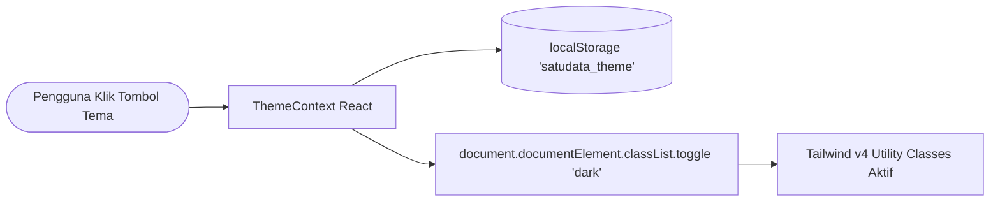
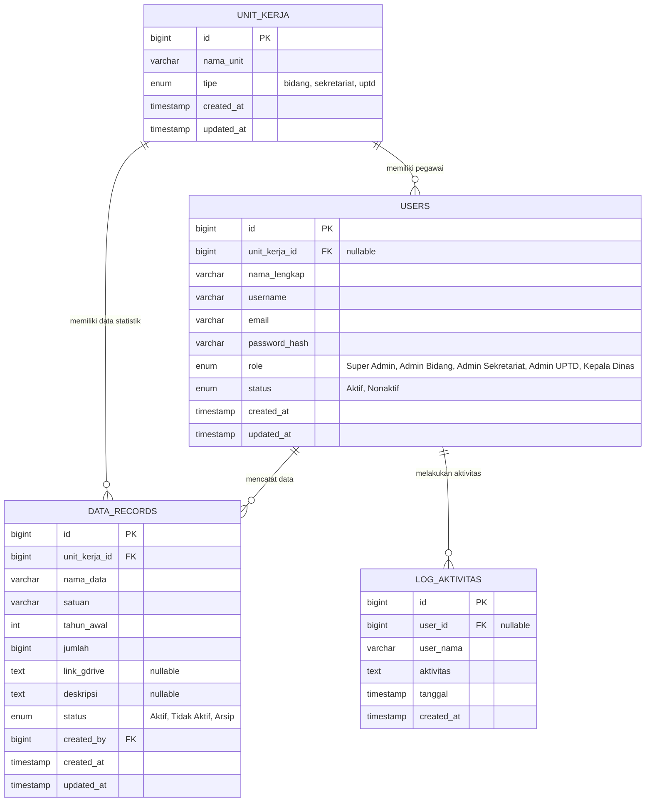
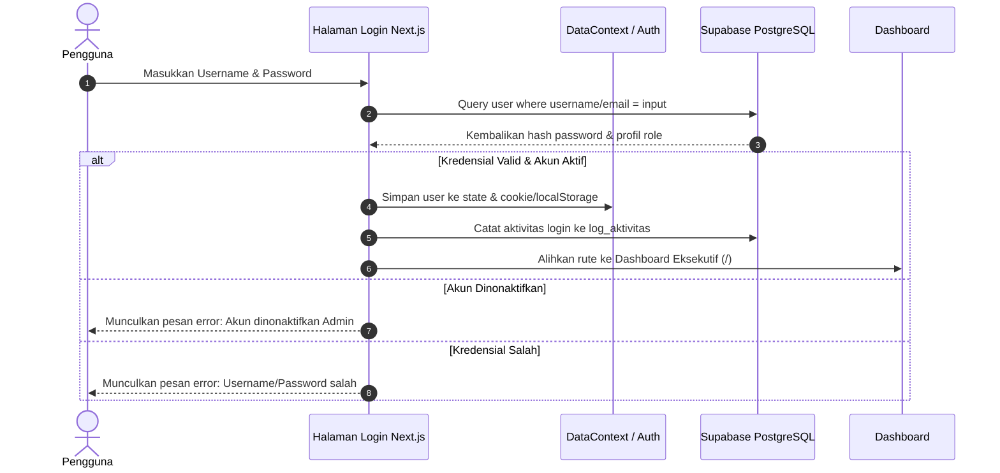
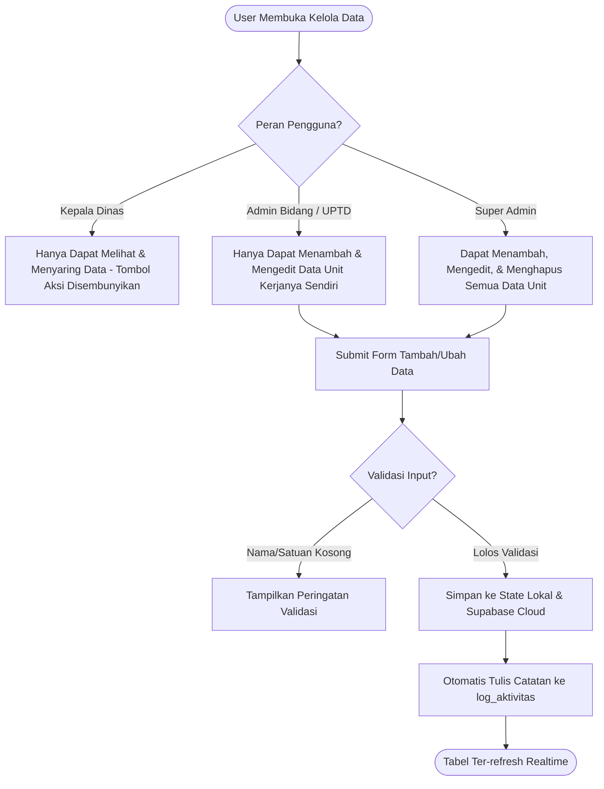
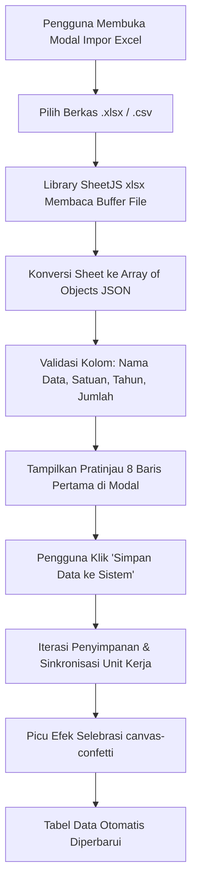

# 📘 BUKU PANDUAN LENGKAP: ARSITEKTUR, DESAIN, DATABASE & MIGRASI SISTEM
## Dari Laravel (MySQL) ke Next.js 15/16 + Supabase (PostgreSQL) + Hosting Vercel
### Sistem Informasi Satu Data Sektoral DINPERINNAKER Kabupaten Purbalingga

---

## 📑 DAFTAR ISI
1. [Ringkasan Eksekutif & Latar Belakang Migrasi](#1-ringkasan-eksekutif--latar-belakang-migrasi)
2. [Dokumentasi Desain & UI/UX Design System](#2-dokumentasi-desain--uiux-design-system)
   - 2.1 [Identitas Visual & Brand Dinas](#21-identitas-visual--brand-dinas)
   - 2.2 [Desain Sistem Dual Tema: Light Mode & Dark Mode](#22-desain-sistem-dual-tema-light-mode--dark-mode)
   - 2.3 [Struktur Tata Letak (Layout) & Komponen Antarmuka](#23-struktur-tata-letak-layout--komponen-antarmuka)
   - 2.4 [Format Dokumen Cetak Ber-Kop Resmi Pemkab Purbalingga](#24-format-dokumen-cetak-ber-kop-resmi-pemkab-purbalingga)
   - 2.5 [Animasi Mikro & Interaktivitas Modern](#25-animasi-mikro--interaktivitas-modern)
3. [Dokumentasi Basis Data (Database) & Perbandingan Skema](#3-dokumentasi-basis-data-database--perbandingan-skema)
   - 3.1 [Entity Relationship Diagram (ERD)](#31-entity-relationship-diagram-erd)
   - 3.2 [Kamus Data & Struktur Tabel Inti](#32-kamus-data--struktur-tabel-inti)
   - 3.3 [Komparasi Arsitektur Database: MySQL Laravel vs Supabase PostgreSQL](#33-komparasi-arsitektur-database-mysql-laravel-vs-supabase-postgresql)
   - 3.4 [Keamanan Data: Row-Level Security (RLS) di Supabase](#34-keamanan-data-row-level-security-rls-di-supabase)
4. [Cara Kerja Sistem & Diagram Alur Bisnis (Workflows)](#4-cara-kerja-sistem--diagram-alur-bisnis-workflows)
   - 4.1 [Alur Autentikasi & Role-Based Access Control (RBAC)](#41-alur-autentikasi--role-based-access-control-rbac)
   - 4.2 [Alur Pengelolaan Data Sektoral & Validasi Kepemilikan Data](#42-alur-pengelolaan-data-sektoral--validasi-kepemilikan-data)
   - 4.3 [Alur Perhitungan Otomatis Pertumbuhan YoY (Year-over-Year)](#43-alur-perhitungan-otomatis-pertumbuhan-yoy-year-over-year)
   - 4.4 [Alur Impor Massal Excel/CSV & Ekspor Laporan](#44-alur-impor-massal-excelcsv--ekspor-laporan)
   - 4.5 [Alur Audit Trail & Pencadangan SQL Mandiri](#45-alur-audit-trail--pencadangan-sql-mandiri)
5. [Catatan Penting Pemetaan Proyek Laravel Eksisting](#5-catatan-penting-pemetaan-proyek-laravel-eksisting)
   - 5.1 [Pemetaan Struktur Direktori (Laravel MVC vs Next.js App Router)](#51-pemetaan-struktur-direktori-laravel-mvc-vs-nextjs-app-router)
   - 5.2 [Pemetaan Controller Laravel ke Halaman & Komponen Next.js](#52-pemetaan-controller-laravel-ke-halaman--komponen-nextjs)
   - 5.3 [Transformasi Sintaks Blade Template ke React (JSX / TSX)](#53-transformasi-sintaks-blade-template-ke-react-jsx--tsx)
   - 5.4 [Perbedaan Paradigma State: Session Cookie vs React Context & Supabase](#54-perbedaan-paradigma-state-session-cookie-vs-react-context--supabase)
6. [Panduan Langkah-Demi-Langkah Migrasi & Hosting (Step-by-Step)](#6-panduan-langkah-demi-langkah-migrasi--hosting-step-by-step)
   - Langkah 1: Persiapan Database Cloud Supabase
   - Langkah 2: Migrasi Skema & Data Awal SQL
   - Langkah 3: Konfigurasi Environment Kunci API (`.env.local`)
   - Langkah 4: Uji Coba Build Produksi Lokal
   - Langkah 5: Deployment Otomatis ke Vercel (100% Gratis)
   - Langkah 6: Verifikasi & Uji Pasca Deployment

---

## 1. 🏢 Ringkasan Eksekutif & Latar Belakang Migrasi

### Mengapa Melakukan Migrasi?
Sistem Satu Data DINPERINNAKER versi awal dibangun menggunakan **PHP Laravel (versi 11/12)** dengan database relasional **MySQL/MariaDB**. Meskipun arsitektur MVC Laravel sangat andal, terdapat beberapa kendala operasional dalam kebutuhan deployment modern dan hosting dinas:

1. **Kendala Server Tradisional**: Hosting Laravel memerlukan server VPS atau cPanel berbayar dengan konfigurasi PHP runtime, Composer, extension PHP (pdo_mysql, mbstring, gd), daemon queue, dan cron job. Hosting murah/gratis seperti InfinityFree sering mengalami masalah timeout limit, file upload restriction, dan tidak tersedianya daemon proses.
2. **Kebutuhan Akses Super Cepat & Gratis**: Dengan migrasi ke **Next.js (App Router)** dan hosting di **Vercel Edge Network**, seluruh aset frontend disajikan dari CDN global dengan waktu muat di bawah 1 detik tanpa biaya server bulanan ($0 / 100% Free).
3. **Database Cloud Terkelola (Serverless PostgreSQL)**: Menggunakan **Supabase** memberikan fleksibilitas database PostgreSQL tingkat enterprise, backup otomatis, dashboard SQL modern, fitur realtime sync, dan aturan keamanan berbasis baris (*Row-Level Security / RLS*).

---

## 2. 🎨 Dokumentasi Desain & UI/UX Design System

### 2.1 Identitas Visual & Brand Dinas
Antarmuka sistem mempertahankan identitas resmi dinas Pemerintah Kabupaten Purbalingga dengan tema bersih, formal, dan berwibawa:

| Parameter | Nilai / Spesifikasi | Implementasi CSS |
| :--- | :--- | :--- |
| **Warna Utama (Primary)** | **Teal DINPERINNAKER `#2a92a2`** | `var(--color-primary)` |
| **Primary Hover** | Deep Teal `#217784` | `var(--color-primary-hover)` |
| **Primary Light Tint** | Soft Mint `#e6f4f6` | `var(--color-primary-light)` |
| **Font Judul / Headings** | **Plus Jakarta Sans** (Weights: 600, 700, 800) | `var(--font-plus-jakarta)` |
| **Font Teks / Body** | **Inter** (Weights: 400, 500, 600) | `var(--font-inter)` |
| **Corner Radius** | `rounded-xl` (12px), `rounded-2xl` (16px), `rounded-3xl` (24px) | Konsisten di semua modal & kartu |
| **Logo Resmi** | Lambang Pemkab Purbalingga | `/images/logo-purbalingga.png` |

---

### 2.2 Desain Sistem Dual Tema: Light Mode & Dark Mode

Sistem Satu Data dilengkapi pemilih tema instan di bilah atas (*Topbar*) dan halaman login. Implementasi menggunakan class-based selector Tailwind CSS v4 (`@custom-variant dark (&:where(.dark, .dark *));`) sehingga warna berubah instan tanpa ketergantungan pada setelan OS pengguna:



#### Spesifikasi Token Warna Mode Terang vs Mode Gelap:

| Elemen UI | Mode Terang (Light Mode) | Mode Malam (Dark Mode) |
| :--- | :--- | :--- |
| **Latar Belakang Layar (Page Body)** | Soft Ice Blue `#f2f7ff` | Deep Space Slate `#0b1120` |
| **Permukaan Kartu (Card Surface)** | Pure White `#ffffff` | Dark Charcoal `#1e293b` |
| **Garis Pembatas (Borders)** | Soft Gray `#eaeff5` | Slate Gray `#334155` |
| **Teks Utama (Headings / Body)** | Deep Navy `#25396e` | Soft Crisp White `#f8fafc` |
| **Teks Keterangan (Muted Text)** | Muted Slate `#7c8db5` | Light Muted Slate `#94a3b8` |
| **Aksen Utama Dinas** | Teal `#2a92a2` | Vibrant Teal `#2dd4bf` |
| **Latar Dropdown Native (`<option>`)** | `#ffffff` | `#1e293b` (mencegah teks tak terbaca) |

---

### 2.3 Struktur Tata Letak (Layout) & Komponen Antarmuka

Arsitektur layout Next.js dibungkus dalam komponen master [`src/components/layout/AppLayout.tsx`](file:///d:/Magang/sistem-satudata-dinperinnaker/satudata-nextjs/src/components/layout/AppLayout.tsx):

1. **Sidebar Navigasi (`Sidebar.tsx`)**:
   - Berada di posisi kiri tetap (*fixed*) selebar 256px (`w-64`).
   - Pada layar desktop: Selalu tampil berdampingan dengan konten utama.
   - Pada layar smartphone/tablet: Bersembunyi dan muncul secara animasi *slide-in drawer* dengan latar belakang transparan ber-efek blur (*backdrop-blur*).
   - Menampilkan logo instansi, menu utama, menu administrasi (terproteksi hak akses Super Admin), info akun aktif, dan tombol Logout.
2. **Topbar Header (`Topbar.tsx`)**:
   - Bilah navigasi atas fixed dengan bayangan lembut (*shadow*).
   - Dilengkapi tombol hamburger untuk membuka menu di mobile.
   - Menampilkan judul halaman aktif.
   - **Tombol Pintas Command Palette (`Ctrl + K`)**.
   - **Tombol Sakelar Tema (Dark / Light Mode)**.
   - **Indikator Status Cloud**: Menampilkan badge hijau jika tersambung ke Supabase Cloud, atau badge abu-abu jika berjalan dalam mode offline fallback.
   - **Quick Role Switcher**: Tombol pengubah akun/peran cepat (1-klik) untuk mempermudah pimpinan dan penguji sistem melihat sudut pandang hak akses berbeda.
3. **Jendela Pencarian Instan (`CommandPalette.tsx`)**:
   - Dapat dipanggil dari halaman mana saja dengan menekan kombinasi tombol keyboard **`Ctrl + K`** (Windows) atau **`Cmd + K`** (macOS).
   - Mencari modul navigasi, klasifikasi data sektoral, dan satuan capaian dinas secara real-time.

---

### 2.4 Format Dokumen Cetak Ber-Kop Resmi Pemkab Purbalingga

Halaman cetak di [`src/app/laporan/print/page.tsx`](file:///d:/Magang/sistem-satudata-dinperinnaker/satudata-nextjs/src/app/laporan/print/page.tsx) dirancang dengan mematuhi tata naskah dinas resmi Pemerintah Kabupaten Purbalingga:

* **Kop Surat Dobel Garis**:
  - Logo resmi Kabupaten Purbalingga di sisi kiri kop.
  - Teks Kop:
    ```text
    PEMERINTAH KABUPATEN PURBALINGGA
    DINAS PERINDUSTRIAN DAN TENAGA KERJA
    Jl. Mayjen Sungkono Telp. (0281) 891013 Purbalingga 53311
    Website: dinperinnaker.purbalinggakab.go.id | Email: dinperinnaker@purbalinggakab.go.id
    ```
  - Garis pemisah ganda hitam tebal (`border-b-4 border-double border-black`).
* **Lembar Pengesahan Pimpinan**:
  - Tanggal resmi cetak dalam format Bahasa Indonesia (misal: *Purbalingga, 21 Oktober 2026*).
  - Kolom tanda tangan resmi **Kepala Dinas Perindustrian dan Tenaga Kerja**.
  - Jabatan, Nama Pejabat (`Johan Arifin, S.Sos., M.Si.`), Golongan Pembina Utama Muda, dan NIP.
* **Aturan Print CSS (`@media print`)**:
  - Menyembunyikan seluruh tombol navigasi, sidebar, dan toolbar (*`.no-print { display: none !important; }`*).
  - Memaksa latar belakang menjadi putih bersih (*100% white paper*) dan teks hitam pekat untuk menghemat tinta pencetak.

---

### 2.5 Animasi Mikro & Interaktivitas Modern

* **Framer Motion**:
  - Staggered animation pada kartu indikator utama di dashboard.
  - Smooth scale and fade-in pada modal form penambahan data.
  - Transisi lebar animated progress bar pada distribusi data unit kerja.
* **Canvas Confetti**:
  - Efek selebrasi taburan konfeti saat pengguna berhasil mengimpor file spreadsheet massal atau mengunduh cadangan database SQL.

---

## 3. 🗄️ Dokumentasi Basis Data (Database) & Perbandingan Skema

### 3.1 Entity Relationship Diagram (ERD)



---

### 3.2 Kamus Data & Struktur Tabel Inti

#### 1. Tabel `unit_kerja` (Master Struktur Organisasi)
Menyimpan klasifikasi struktur organisasi DINPERINNAKER Kabupaten Purbalingga.
* **`id`** (`BIGINT`, Primary Key, Auto Increment)
* **`nama_unit`** (`VARCHAR(255)`, Not Null): Nama bidang/unit (contoh: *Bidang Hubungan Industrial dan Jaminan Sosial Tenaga Kerja*).
* **`tipe`** (`VARCHAR(50)`, Not Null): Kategori unit (`bidang`, `sekretariat`, `uptd`).
* **`created_at`**, **`updated_at`** (`TIMESTAMPTZ`): Jejak waktu pencatatan.

#### 2. Tabel `users` / `profiles` (Manajemen Akun Pegawai & RBAC)
* **`id`** (`BIGINT` / `UUID`, Primary Key): ID pengguna.
* **`unit_kerja_id`** (`BIGINT`, Foreign Key ke `unit_kerja.id`, Nullable): ID unit kerja yang dipegang (khusus Super Admin & Kepala Dinas bernilai `NULL`).
* **`nama` / `nama_lengkap`** (`VARCHAR(255)`, Not Null): Nama lengkap pegawai beserta gelar.
* **`username`** (`VARCHAR(100)`, Unique, Not Null): Nama akun untuk masuk ke sistem.
* **`email`** (`VARCHAR(255)`, Unique, Not Null): Alamat pos elektronik dinas.
* **`password`** (`VARCHAR(255)`, Not Null): Hash kata sandi (menggunakan enkripsi bcrypt di Laravel atau Supabase Auth).
* **`role`** (`VARCHAR(50)`, Not Null): Peran hak akses:
  - `Super Admin`: Akses tanpa batas ke seluruh modul sistem.
  - `Admin Bidang`: Mengelola data khusus bidang HIJTK atau PPTK.
  - `Admin Sekretariat`: Mengelola data perencanaan, keuangan, dan umum kepegawaian.
  - `Admin UPTD`: Mengelola data pelatihan BLK atau pengembangan industri logam PILOG.
  - `Kepala Dinas`: Akses eksekutif *read-only* untuk memantau grafik dan mencetak laporan resmi.
* **`status`** (`VARCHAR(20)`, Default `'Aktif'`): Status akun (`Aktif` atau `Nonaktif`).

#### 3. Tabel `data_records` (Data Statistik Sektoral)
* **`id`** (`BIGINT`, Primary Key, Auto Increment)
* **`unit_kerja_id`** (`BIGINT`, Foreign Key ke `unit_kerja.id`, Not Null): Unit kerja pemilik data.
* **`nama_data`** (`VARCHAR(255)`, Not Null): Judul indikator/data statistik sektoral.
* **`satuan`** (`VARCHAR(100)`, Not Null): Satuan pengukuran (contoh: *Orang*, *Kasus*, *Perusahaan*, *Dokumen*).
* **`tahun_awal`** (`INT`, Not Null): Tahun periode data (contoh: *2026*).
* **`jumlah`** (`BIGINT`, Default 0): Nilai angka capaian data.
* **`link_gdrive`** (`TEXT`, Nullable): Tautan berkas bukti fisik digital di Google Drive.
* **`deskripsi`** (`TEXT`, Nullable): Keterangan rinci atau metodologi pengumpulan data.
* **`status`** (`VARCHAR(50)`, Default `'Aktif'`): Status data (`Aktif`, `Tidak Aktif`, `Arsip`).
* **`created_by`** (`BIGINT`, Foreign Key ke `users.id`, Nullable): ID user pembuat data.

#### 4. Tabel `log_aktivitas` (Audit Trail Sistem)
* **`id`** (`BIGINT`, Primary Key, Auto Increment)
* **`user_id`** (`BIGINT`, Nullable): ID user yang melakukan aksi.
* **`user_nama`** (`VARCHAR(255)`): Nama pegawai yang terekam pada saat aksi.
* **`aktivitas`** (`TEXT`, Not Null): Narasi rekaman aksi (contoh: *Menambahkan data sektoral baru: Pelatihan Vokasi BNSP*).
* **`tanggal`** (`TIMESTAMPTZ`, Default `NOW()`): Waktu kejadian perkara.

---

### 3.3 Komparasi Arsitektur Database: MySQL Laravel vs Supabase PostgreSQL

| Karakteristik | Laravel Eksisting (MySQL / MariaDB) | Next.js Modern (Supabase PostgreSQL) |
| :--- | :--- | :--- |
| **Mesin Basis Data** | MySQL 8.0 / MariaDB 10.x | PostgreSQL 15+ Serverless Cloud |
| **Primary Key ID** | `BIGINT UNSIGNED AUTO_INCREMENT` | `BIGINT GENERATED ALWAYS AS IDENTITY` atau `UUID` |
| **Format Waktu** | `DATETIME` / `TIMESTAMP` tanpa timezone | `TIMESTAMPTZ` (ISO-8601 dengan offset zona waktu WIB) |
| **Keamanan Data** | Bergantung pada middleware PHP Laravel | **Row-Level Security (RLS)** bawaan engine PostgreSQL |
| **Fitur Realtime** | Memerlukan Pusher / Laravel Reverb / Redis | Terintegrasi langsung via **Supabase Realtime WebSockets** |
| **Penyimpanan Berkas** | Local Storage `public/storage` (terbatas di hosting) | Integrasi Tautan Google Drive / Supabase Storage S3 |
| **Biaya Pemeliharaan**| Sewa server bulanan | **Gratis (Free Tier Supabase: 500MB DB & 50.000 user aktif)** |

---

### 3.4 Keamanan Data: Row-Level Security (RLS) di Supabase

Pada Supabase PostgreSQL, aturan keamanan data diatur langsung di tingkat basis data. Contoh skrip proteksi data:

```sql
-- Mengaktifkan RLS pada tabel data
ALTER TABLE data_records ENABLE ROW LEVEL SECURITY;

-- 1. Siapapun yang terautentikasi dapat membaca data aktif
CREATE POLICY "Public Read Access" 
ON data_records FOR SELECT 
USING (true);

-- 2. Admin hanya dapat mengubah data unit kerjanya sendiri
CREATE POLICY "Unit Kerja Update Policy" 
ON data_records FOR UPDATE 
USING (
  unit_kerja_id = (SELECT unit_kerja_id FROM users WHERE id = auth.uid())
  OR (SELECT role FROM users WHERE id = auth.uid()) = 'Super Admin'
);
```

---

## 4. ⚙️ Cara Kerja Sistem & Diagram Alur Bisnis (Workflows)

### 4.1 Alur Autentikasi & Role-Based Access Control (RBAC)



---

### 4.2 Alur Pengelolaan Data Sektoral & Validasi Kepemilikan Data



---

### 4.3 Alur Perhitungan Otomatis Pertumbuhan YoY (Year-over-Year)

Salah satu keunggulan versi Next.js adalah tersedianya kalkulasi dinamik indikator kinerja tahunan secara instan di peramban tanpa membebani query SQL:

$$Pertumbuhan\ YoY\ (\%) = \frac{Capaian\ Tahun\ N - Capaian\ Tahun\ (N - 1)}{Capaian\ Tahun\ (N - 1)} \times 100\%$$

* **Nilai Positif ($> 0\%$)**: Badge hijau berikon panah naik (`↑ +12.4% YoY`).
* **Nilai Netral ($= 0\%$)**: Badge abu-abu berikon garis datar (`- 0.0% YoY`).
* **Nilai Menurun ($< 0\%$)**: Badge merah berikon panah turun (`↓ -5.2% YoY`).

---

### 4.4 Alur Impor Massal Excel/CSV & Ekspor Laporan



---

### 4.5 Alur Audit Trail & Pencadangan SQL Mandiri

Pada menu **Backup & Sistem** ([`src/app/backup/page.tsx`](file:///d:/Magang/sistem-satudata-dinperinnaker/satudata-nextjs/src/app/backup/page.tsx)):
1. Pengguna (khusus Super Admin) menekan tombol **"Unduh Cadangan SQL"**.
2. Komponen membaca seluruh memori aktif tabel `unit_kerja` dan `data_records`.
3. Generator otomatis merangkai klausa SQL terstandar:
   ```sql
   TRUNCATE TABLE unit_kerja CASCADE;
   INSERT INTO unit_kerja (id, nama_unit, tipe) VALUES (...);
   TRUNCATE TABLE data_records CASCADE;
   INSERT INTO data_records (...) VALUES (...);
   ```
4. Dibuat blob objek file `Backup_SatuData_DINPERINNAKER_2026.sql` yang langsung terunduh secara instan ke komputer pengguna tanpa memerlukan akses terminal server.

---

## 5. 🔍 Catatan Penting Pemetaan Proyek Laravel Eksisting

### 5.1 Pemetaan Struktur Direktori (Laravel MVC vs Next.js App Router)

| Komponen Arsitektur | Lokasi di Laravel Eksisting | Lokasi di Next.js 15/16 Modern |
| :--- | :--- | :--- |
| **Routing Halaman** | `routes/web.php` | Folder berbasis sistem file di `src/app/**/page.tsx` |
| **Layout Induk** | `resources/views/layouts/app.blade.php` | `src/app/layout.tsx` & `src/components/layout/AppLayout.tsx` |
| **Tampilan Halaman (Views)**| `resources/views/{modul}/index.blade.php`| `src/app/{modul}/page.tsx` (React Server/Client Component) |
| **Logika Controller** | `app/Http/Controllers/*.php` | Logika di `src/context/DataContext.tsx` atau Server Actions |
| **Model & Relasi** | `app/Models/*.php` (Eloquent ORM) | `src/types/index.ts` (TypeScript Interfaces) + Supabase Client |
| **Middleware Keamanan** | `app/Http/Middleware/*.php` | Proteksi di `AppLayout.tsx` & RLS Database Supabase |
| **Aset Statis (Logo/Foto)**| `public/images/*` | `public/images/*` (diakses langsung dari root URL) |
| **Konfigurasi Lingkungan** | `.env` | `.env.local` (Next.js Public Variables `NEXT_PUBLIC_*`) |

---

### 5.2 Pemetaan Controller Laravel ke Halaman & Komponen Next.js

```text
[Laravel Eksisting]                           [Next.js Modern]
AuthController.php                   ===>    src/app/login/page.tsx
DashboardController.php              ===>    src/app/page.tsx (Dashboard Eksekutif)
DataController.php                   ===>    src/app/kelola-data/page.tsx
LaporanController.php                ===>    src/app/laporan/page.tsx
LaporanController@print              ===>    src/app/laporan/print/page.tsx (Cetak Kop Surat)
UnitKerjaController.php              ===>    src/app/unit-kerja/page.tsx
UserController.php                   ===>    src/app/users/page.tsx
BackupController.php                 ===>    src/app/backup/page.tsx
```

---

### 5.3 Transformasi Sintaks Blade Template ke React (JSX / TSX)

Bagi pengembang yang terbiasa dengan sintaks Blade Laravel, berikut panduan padanan sintaks saat beralih ke Next.js:

#### 1. Menampilkan Nilai Variabel
* **Blade Laravel**: `{{ $data->nama_data }}`
* **Next.js React**: `{item.nama_data}`

#### 2. Pengkondisian (If / Else)
* **Blade Laravel**:
  ```blade
  @if($item->status == 'Aktif')
      <span class="badge bg-success">Aktif</span>
  @else
      <span class="badge bg-danger">Nonaktif</span>
  @endif
  ```
* **Next.js React**:
  ```tsx
  {item.status === 'Aktif' ? (
    <span className="bg-emerald-50 text-emerald-700">Aktif</span>
  ) : (
    <span className="bg-rose-50 text-rose-700">Nonaktif</span>
  )}
  ```

#### 3. Perulangan Data (Foreach)
* **Blade Laravel**:
  ```blade
  @foreach($unitKerjas as $unit)
      <li>{{ $unit->nama_unit }}</li>
  @endforeach
  ```
* **Next.js React**:
  ```tsx
  {unitKerjas.map((unit) => (
    <li key={unit.id}>{unit.nama_unit}</li>
  ))}
  ```

#### 4. Proteksi Hak Akses (RBAC Directives)
* **Blade Laravel**:
  ```blade
  @can('is-superadmin')
      <a href="{{ route('users.index') }}">Pengguna</a>
  @endcan
  ```
* **Next.js React**:
  ```tsx
  {currentUser?.role === 'Super Admin' && (
    <Link href="/users">Pengguna</Link>
  )}
  ```

---

### 5.4 Perbedaan Paradigma State: Session Cookie vs React Context & Supabase

* **Pada Laravel**: Server menyimpan ID sesi pengguna di cookie browser. Setiap kali halaman berpindah (*page reload*), server PHP membangun ulang seluruh HTML (*Server-Side Rendering tradisional*).
* **Pada Next.js**: State dikelola menggunakan **React Context (`DataContext.tsx`)** yang menyimpan data di memori aplikasi klien secara cepat. Untuk menjaga data tetap sinkron saat pengguna offline atau belum menghubungkan API Supabase, data disimpan di **`localStorage`**. Saat kredensial Supabase terhubung, aplikasi langsung menyinkronkan data dua arah secara aman.

---

## 6. 🚀 Panduan Langkah-Demi-Langkah Migrasi & Hosting (Step-by-Step)

### Langkah 1: Persiapan Database Cloud Supabase
1. Kunjungi [https://supabase.com](https://supabase.com) dan buat akun (dapat menggunakan akun GitHub).
2. Klik tombol **New Project**.
3. Beri nama proyek: `satudata-dinperinnaker-purbalingga`.
4. Pilih region yang terdekat untuk latensi tercepat: **Singapore (ap-southeast-1)**.
5. Buat dan simpan password database yang kuat.

---

### Langkah 2: Migrasi Skema & Data Awal SQL
1. Di dashboard Supabase, buka menu **SQL Editor** (ikon terminal di bilah samping).
2. Klik **New Query**.
3. Buka file skema yang telah kami sediakan di:
   📄 [`satudata-nextjs/supabase_schema.sql`](file:///d:/Magang/sistem-satudata-dinperinnaker/satudata-nextjs/supabase_schema.sql)
4. Salin seluruh isi skrip tersebut dan tempelkan ke SQL Editor Supabase.
5. Klik **Run** (tombol hijau).
6. Seluruh tabel (`unit_kerja`, `users`, `data_records`, `log_aktivitas`), indeks performa, aturan RLS, dan 6 master unit kerja dinas akan terbuat seketika.

---

### Langkah 3: Konfigurasi Environment Kunci API (`.env.local`)
1. Di dashboard Supabase, masuk ke menu **Project Settings** (ikon gerigi) $\rightarrow$ **API**.
2. Salin nilai:
   - **Project URL**
   - **Project API Keys** (pilih yang **`anon public`**)
3. Buat file baru bernama `.env.local` di dalam folder `satudata-nextjs/`:
   ```env
   NEXT_PUBLIC_SUPABASE_URL=https://xxxxxxxxxxxxxxxx.supabase.co
   NEXT_PUBLIC_SUPABASE_ANON_KEY=eyJhbGciOiJIUzI1NiIsInR5cCI6IkpXVCJ9.xxxxxxxxxxxx
   ```

---

### Langkah 4: Uji Coba Build Produksi Lokal
Sebelum mengunggah ke internet, pastikan proyek lolos uji kompilasi produksi di komputer lokal Anda:

```powershell
cd d:\Magang\sistem-satudata-dinperinnaker\satudata-nextjs
npm run build
```

Jika muncul pesan:
```text
✓ Compiled successfully
✓ Generating static pages (11/11)
```
Maka proyek Anda sudah 100% bebas dari kesalahan (*zero errors*) dan siap dipublikasikan ke Vercel.

---

### Langkah 5: Deployment Otomatis ke Vercel (100% Gratis)

#### Cara A: Melalui GitHub (Rekomendasi Terbaik)
1. Inisialisasi git dan unggah folder `satudata-nextjs` ke repository GitHub Anda:
   ```powershell
   cd d:\Magang\sistem-satudata-dinperinnaker\satudata-nextjs
   git init
   git add .
   git commit -m "feat: migrasi satu data dinperinnaker ke nextjs supabase"
   git branch -M main
   git remote add origin https://github.com/USERNAME_ANDA/satudata-nextjs.git
   git push -u origin main
   ```
2. Buka [https://vercel.com](https://vercel.com) dan login menggunakan akun GitHub Anda.
3. Klik tombol **Add New...** $\rightarrow$ **Project**.
4. Pilih repositori `satudata-nextjs` yang baru saja Anda unggah.
5. Pada bagian **Environment Variables**, masukkan:
   - `NEXT_PUBLIC_SUPABASE_URL` = (URL Supabase Anda)
   - `NEXT_PUBLIC_SUPABASE_ANON_KEY` = (Kunci Anon Supabase Anda)
6. Klik **Deploy**. Dalam waktu sekitar 1 menit, website Anda sudah aktif dan live!

#### Cara B: Menggunakan Vercel CLI (Langsung dari Terminal)
```powershell
npm i -g vercel
cd d:\Magang\sistem-satudata-dinperinnaker\satudata-nextjs
vercel
```
Ikuti instruksi di layar, pilih default untuk semua pertanyaan, dan tautan domain `*.vercel.app` Anda akan langsung diterbitkan!

---

### Langkah 6: Verifikasi & Uji Pasca Deployment

Setelah website aktif di alamat Vercel:
1. Uji masuk menggunakan akun default (misal: `superadmin` / `SuperAdmin#2026`).
2. Uji coba sakelar **Mode Terang dan Gelap** di Topbar.
3. Coba tekan tombol keyboard **`Ctrl + K`** untuk memanggil Command Palette.
4. Uji coba tambah satu data sektoral baru dan periksa apakah indikator cloud Supabase menyala hijau.
5. Buka menu Laporan $\rightarrow$ Klik **Cetak / PDF Resmi** untuk memverifikasi kerapian dokumen ber-Kop Surat Pemkab Purbalingga.
6. Coba fitur **Ekspor Excel** dan **Impor Massal Excel/CSV** untuk memastikan pembaca spreadsheet berjalan sempurna di browser pengguna.

---
*Dokumentasi ini disusun secara khusus untuk Dinas Perindustrian dan Tenaga Kerja Kabupaten Purbalingga sebagai pedoman transformasi digital Satu Data menuju arsitektur modern berkinerja tinggi.*
