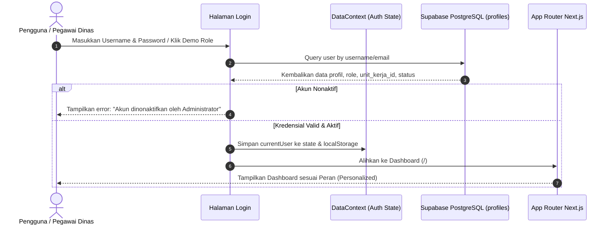
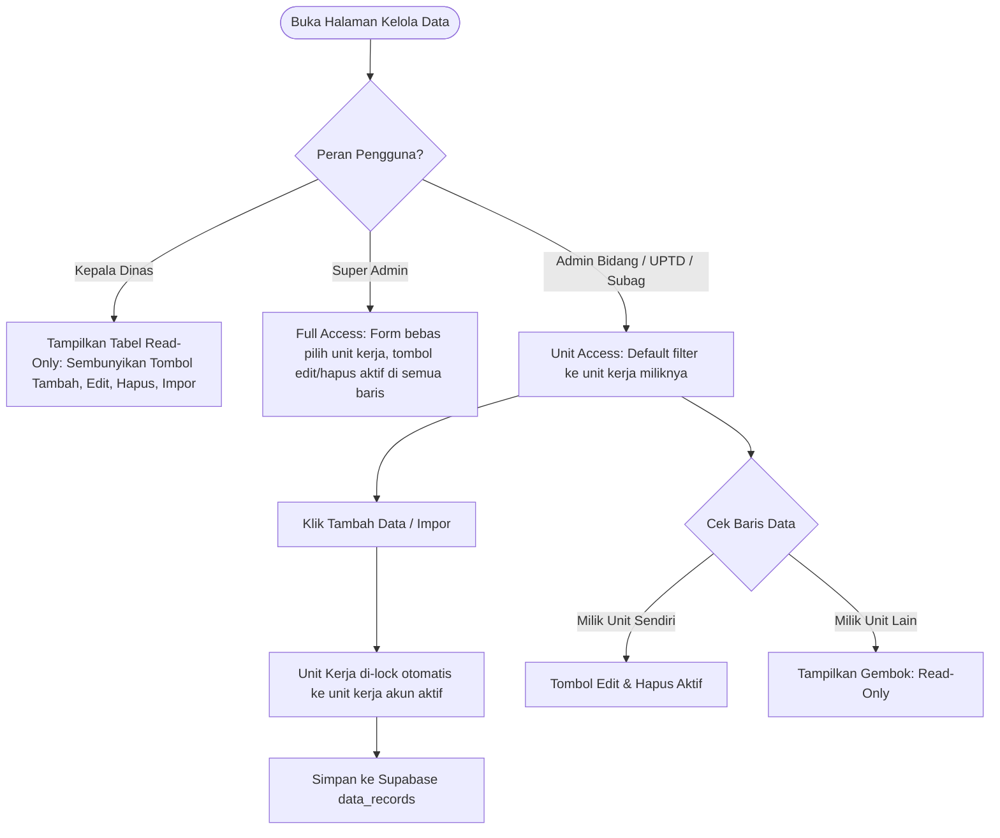

# 🔐 Rencana Implementasi: Pembaruan Alur Sistem & Hak Akses (RBAC)
## Satu Data Sektoral DINPERINNAKER Kabupaten Purbalingga

Dokumen rencana kerja ini merancang pembaruan menyeluruh pada **alur sistem (system flows)**, mencakup mekanisme **Login & Otentikasi**, **Otorisasi Berbasis Peran (RBAC)** untuk 5 tingkatan pengguna: **Super Admin**, **Admin Bidang**, **Admin UPTD**, **Admin Subag (Sekretariat)**, dan **Kepala Dinas**, serta isolasi data dan proteksi rute di seluruh modul antarmuka.

---

## 🎯 Tujuan Pembaruan Alur Sistem
1. **Alur Login yang Terstandar & Fleksibel**:
   - Mendukung otentikasi kredensial pengguna dari Supabase Cloud (tabel `profiles`) dan sinkronisasi status akun (`Aktif` vs `Nonaktif`).
   - Menyediakan tombol pemilih peran demo cepat (Quick Role Selector) yang mencakup seluruh peran: Super Admin, Admin Bidang (HIJTK/PPTK), Admin UPTD (BLK/PILOG), Admin Subag (Renkeu/Umpeg), dan Kepala Dinas.
2. **Isolasi & Validasi Kepemilikan Data Sektoral**:
   - Memastikan **Admin Bidang**, **Admin UPTD**, dan **Admin Subag** hanya dapat **menambah, mengedit, dan menghapus data milik unit kerjanya sendiri**.
   - Input formulir penambahan data secara otomatis mengunci (*lock*) unit kerja sesuai akun yang sedang bertugas guna mencegah salah entri.
   - Menyediakan tanda kepemilikan (*Badge Ownership*) pada tabel data (`Milik Unit Anda` vs `Milik Unit Lain`).
3. **Penyajian Dashboard Terpersonalisasi (Personalized Dashboard)**:
   - Menampilkan salam penyambutan dan ringkasan metrik khusus sesuai bidang tugas masing-masing akun (misal: Admin BLK langsung melihat capaian pelatihan vokasi, Admin Renkeu melihat serapan anggaran).
4. **Mode Eksekutif Read-Only untuk Kepala Dinas**:
   - Memastikan Kepala Dinas mendapatkan visualisasi KPI makro dan tren YoY dinas tanpa tombol ubah/hapus yang dapat merusak integritas data, serta akses langsung ke cetak laporan ber-Kop Surat dinas.
5. **Proteksi Rute Ketat (Route Guarding)**:
   - Menu administrasi (`/users`, `/unit-kerja`, `/backup`) sepenuhnya terkunci hanya untuk Super Admin dengan tampilan halaman peringatan formal jika dibuka manual.

---

## 👥 Matriks Hak Akses Peran (RBAC Matrix)

| Modul & Tindakan | Super Admin | Admin Bidang | Admin UPTD | Admin Subag | Kepala Dinas |
| :--- | :---: | :---: | :---: | :---: | :---: |
| **Login ke Sistem** | ✅ | ✅ | ✅ | ✅ | ✅ |
| **Dashboard Agregasi Dinas** | ✅ | ✅ | ✅ | ✅ | ✅ |
| **Widget KPI Khusus Unit** | — | ✅ (Bidang) | ✅ (UPTD) | ✅ (Subag) | ✅ (Makro) |
| **Lihat Data Semua Unit** | ✅ | ✅ (Read) | ✅ (Read) | ✅ (Read) | ✅ (Read) |
| **Tambah Data Sektoral** | ✅ (Semua Unit) | ✅ (Unit Sendiri) | ✅ (Unit Sendiri) | ✅ (Unit Sendiri) | ❌ |
| **Ubah / Hapus Data** | ✅ (Semua Data) | ✅ (Hanya Unitnya) | ✅ (Hanya Unitnya) | ✅ (Hanya Unitnya) | ❌ |
| **Impor Spreadsheet Excel** | ✅ (Bebas) | ✅ (Auto-Unit) | ✅ (Auto-Unit) | ✅ (Auto-Unit) | ❌ |
| **Cetak Dokumen Kop Surat** | ✅ | ✅ | ✅ | ✅ | ✅ (Utama) |
| **Kelola Master Unit Kerja** | ✅ | ❌ | ❌ | ❌ | ❌ |
| **Kelola Akun & Sandi Pengguna** | ✅ | ❌ | ❌ | ❌ | ❌ |
| **Unduh SQL & Audit Trail** | ✅ | ❌ | ❌ | ❌ | ❌ |

---

## 🔄 Diagram Alur Bisnis Sistem

### 1. Alur Login & Distribusi Peran (Sequence Diagram)


### 2. Alur Kelola Data Berdasarkan Peran (Flowchart)


---

## 📋 Rincian Perubahan Berkas

### 1. Halaman Login ([`src/app/login/page.tsx`](file:///d:/Magang/sistem-satudata-dinperinnaker/satudata-nextjs/src/app/login/page.tsx))
#### [MODIFY] [`src/app/login/page.tsx`](file:///d:/Magang/sistem-satudata-dinperinnaker/satudata-nextjs/src/app/login/page.tsx)
* Memperbarui tombol **Quick Demo Access (1-Klik)** menjadi representasi lengkap:
  - 👑 **Super Admin** (`superadmin`)
  - 👔 **Kepala Dinas** (`kadis`)
  - 💼 **Admin Bidang HIJTK** (`admin_hijtk`) & **Admin Bidang PPTK** (`admin_pptk`)
  - ⚙️ **Admin UPTD BLK** (`admin_blk`) & **Admin UPTD PILOG** (`admin_pilog`)
  - 📋 **Admin Subag Renkeu** (`admin_renkeu`) & **Admin Subag Umpeg** (`admin_umpeg`)
* Menambahkan label deskripsi unit kerja pada saat memilih peran.
* Memastikan validasi status `Nonaktif` memunculkan alert banner yang jelas.

---

### 2. Header & Topbar ([`src/components/layout/Topbar.tsx`](file:///d:/Magang/sistem-satudata-dinperinnaker/satudata-nextjs/src/components/layout/Topbar.tsx))
#### [MODIFY] [`src/components/layout/Topbar.tsx`](file:///d:/Magang/sistem-satudata-dinperinnaker/satudata-nextjs/src/components/layout/Topbar.tsx)
* Memperbarui dropdown **Quick Role Switcher**:
  - Mengelompokkan daftar peran ke dalam kategori: *Pimpinan & Super Admin*, *Bidang Teknis*, *Sekretariat (Subag)*, dan *UPTD*.
  - Menampilkan badge nama unit kerja di sebelah nama pengguna aktif agar penguji sistem langsung mengetahui akun unit mana yang sedang aktif.

---

### 3. Sidebar Navigasi ([`src/components/layout/Sidebar.tsx`](file:///d:/Magang/sistem-satudata-dinperinnaker/satudata-nextjs/src/components/layout/Sidebar.tsx))
#### [MODIFY] [`src/components/layout/Sidebar.tsx`](file:///d:/Magang/sistem-satudata-dinperinnaker/satudata-nextjs/src/components/layout/Sidebar.tsx)
* Menampilkan informasi unit kerja yang diampu di bawah avatar pengguna pada panel samping (footer).
* Menyembunyikan menu **Administrasi** (`Unit Kerja`, `Pengguna`, `Backup`) dari Admin Bidang, Admin UPTD, Admin Subag, dan Kepala Dinas.
* Tombol Logout dengan konfirmasi pembersihan sesi.

---

### 4. Dashboard Terpersonalisasi ([`src/app/page.tsx`](file:///d:/Magang/sistem-satudata-dinperinnaker/satudata-nextjs/src/app/page.tsx))
#### [MODIFY] [`src/app/page.tsx`](file:///d:/Magang/sistem-satudata-dinperinnaker/satudata-nextjs/src/app/page.tsx)
* Menambahkan **Banner Personalisasi Peran**:
  - Menampilkan nama pejabat/admin dan unit kerjanya (misal: *"Selamat Datang, Admin Sub Bagian Perencanaan & Keuangan"*).
* Menyajikan ringkasan kartu statistik dinamis:
  - Untuk **Admin Bidang / UPTD / Subag**: Menampilkan kartu sorotan capaian unit kerja mereka (Total Indikator Unit, Akumulasi Nilai Capaian Unit, Tautan Bukti Fisik GDrive Unit) berdampingan dengan statistik dinas.
  - Untuk **Kepala Dinas**: Menampilkan tombol pintas ke *"Cetak Laporan Resmi Ber-Kop"* dan analisis tren YoY makro.
  - Untuk **Super Admin**: Menampilkan pintasan ke Manajemen User, Master Unit Kerja, dan Status Database Cloud Supabase.

---

### 5. Kelola Data Sektoral ([`src/app/kelola-data/page.tsx`](file:///d:/Magang/sistem-satudata-dinperinnaker/satudata-nextjs/src/app/kelola-data/page.tsx))
#### [MODIFY] [`src/app/kelola-data/page.tsx`](file:///d:/Magang/sistem-satudata-dinperinnaker/satudata-nextjs/src/app/kelola-data/page.tsx)
* **Default Filter Unit**: Saat Admin Bidang, UPTD, atau Subag membuka halaman, filter unit kerja secara otomatis terpasang pada unit kerja mereka.
* **Badge Kepemilikan Data**: Pada kolom tabel data, baris data milik unit kerja aktif diberi penanda visual khusus (*"Milik Unit Anda"*).
* **Proteksi Aksi Edit & Hapus**:
  - Data milik unit kerja lain dilindungi dengan ikon gembok dan tombol aksi dinonaktifkan.
  - Super Admin tetap memiliki akses ubah & hapus di seluruh data.
* **Formulir Tambah Data**:
  - Untuk Admin Bidang/UPTD/Subag: Dropdown Unit Kerja dinonaktifkan (otomatis terkunci ke unit akunnya).
* **Mode Kepala Dinas**:
  - Seluruh tombol mutasi data (Tambah Data, Edit, Hapus, Impor Excel) otomatis disembunyikan.

---

### 6. Modal Impor Data Excel ([`src/components/data/ImportDataModal.tsx`](file:///d:/Magang/sistem-satudata-dinperinnaker/satudata-nextjs/src/components/data/ImportDataModal.tsx))
#### [MODIFY] [`src/components/data/ImportDataModal.tsx`](file:///d:/Magang/sistem-satudata-dinperinnaker/satudata-nextjs/src/components/data/ImportDataModal.tsx)
* Memastikan baris data yang diimpor oleh Admin Bidang, Admin UPTD, atau Admin Subag secara otomatis terkunci ke `unit_kerja_id` milik akun tersebut, meskipun file Excel tidak mencantumkan nama unit kerja.

---

## 🧪 Rencana Verifikasi (Verification Plan)

### 1. Automated Verification
* **TypeScript & Build Verification**:
  ```powershell
  npm run build
  ```
  *(Memastikan tidak ada konflik tipe data role atau properti kompilasi)*

### 2. Manual Verification di Browser (`http://localhost:3000`)
1. **Pengujian Alur Login**:
   - Masuk menggunakan masing-masing tombol Quick Demo Role di `/login`.
   - Coba login dengan username `admin_hijtk`, `admin_blk`, `admin_renkeu`, `kadis`, dan `superadmin`.
2. **Pengujian Alur Admin Bidang (HIJTK / PPTK)**:
   - Verifikasi dashboard menampilkan banner Bidang HIJTK.
   - Buka Kelola Data: Verifikasi hanya data HIJTK yang dapat diubah/dihapus.
   - Coba klik Tambah Data: Verifikasi dropdown unit terkunci ke HIJTK.
   - Verifikasi menu Administrasi tidak muncul di Sidebar.
3. **Pengujian Alur Admin UPTD (BLK / PILOG)**:
   - Verifikasi dashboard dan formulir terkunci ke UPTD BLK/PILOG.
4. **Pengujian Alur Admin Subag (Renkeu / Umpeg)**:
   - Verifikasi data terkunci ke Sub Bagian Perencanaan/Keuangan atau Umum/Kepegawaian.
5. **Pengujian Alur Kepala Dinas**:
   - Verifikasi dashboard dalam mode eksekutif.
   - Buka Kelola Data: Pastikan tidak ada tombol Tambah/Edit/Hapus.
   - Buka Laporan $\rightarrow$ Cetak Laporan Resmi: Verifikasi kop surat dan nama tanda tangan Kepala Dinas.
6. **Pengujian Alur Super Admin**:
   - Verifikasi akses penuh ke `/users`, `/unit-kerja`, `/backup`, serta kemampuan mengubah seluruh data unit kerja.
