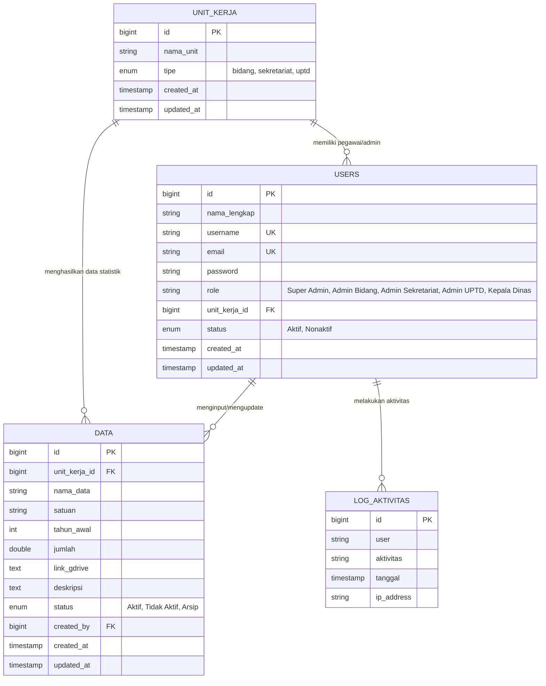
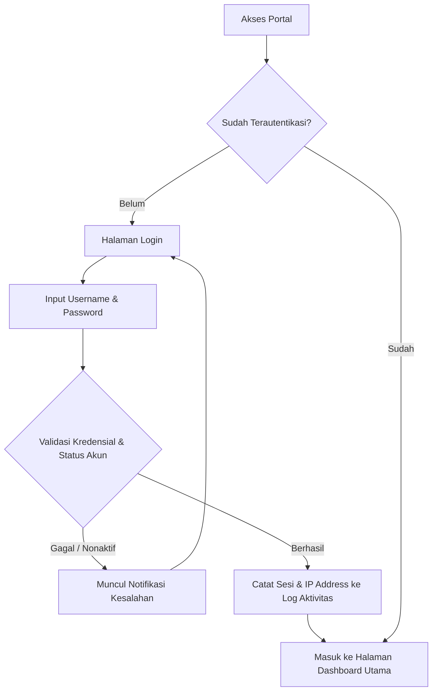
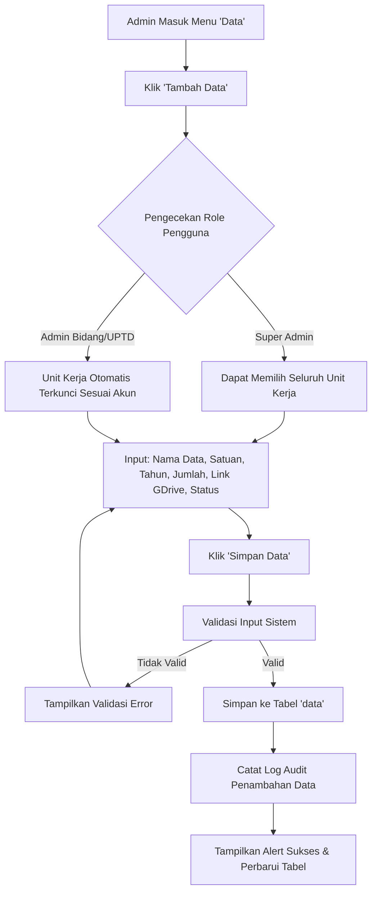
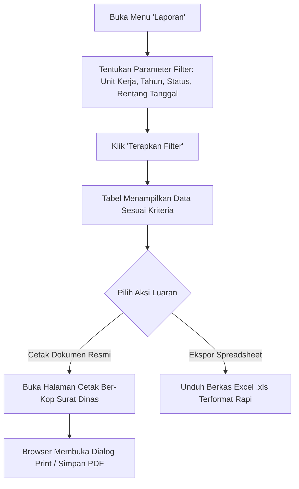

# 📘 DOKUMENTASI SISTEM INFORMASI SATU DATA DINPERINNAKER
### Dinas Perindustrian dan Tenaga Kerja Kabupaten Purbalingga

---

## 📑 DAFTAR ISI
1. [Gambaran Umum & Latar Belakang](#1-gambaran-umum--latar-belakang)
2. [Tujuan & Manfaat Sistem](#2-tujuan--manfaat-sistem)
3. [Arsitektur Sistem & Spesifikasi Teknologi](#3-arsitektur-sistem--spesifikasi-teknologi)
4. [Hak Akses Pengguna (Role-Based Access Control)](#4-hak-akses-pengguna-role-based-access-control)
5. [Struktur Basis Data (Database Schema & ERD)](#5-struktur-basis-data-database-schema--erd)
6. [Struktur Navigasi & Modul Sistem](#6-struktur-navigasi--modul-sistem)
7. [Alur Kerja Sistem (Business Process & Workflow)](#7-alur-kerja-sistem-business-process--workflow)
8. [Daftar Akun Pengujian Default](#8-daftar-akun-pengujian-default)
9. [Panduan Pengoperasian Pengguna (User Manual)](#9-panduan-pengoperasian-pengguna-user-manual)
10. [Panduan Instalasi & Pemeliharaan Sistem](#10-panduan-instalasi--pemeliharaan-sistem)

---

## 1. 🏢 Gambaran Umum & Latar Belakang

**Sistem Informasi Satu Data DINPERINNAKER** adalah platform portal data statistik sektoral berbasis web yang terintegrasi untuk mengelola, merekapitulasi, memantau, dan mencetak laporan kinerja sektoral di lingkungan **Dinas Perindustrian dan Tenaga Kerja Kabupaten Purbalingga**.

Aplikasi ini mencakup seluruh unit kerja operasional dinas, yang terdiri dari:
1. **Bidang Hubungan Industrial dan Jaminan Sosial Tenaga Kerja (HIJTK)**
2. **Bidang Pelatihan dan Penempatan Tenaga Kerja (PPTK)**
3. **Sub Bagian Perencanaan dan Keuangan (Sekretariat)**
4. **Sub Bagian Umum dan Kepegawaian (Sekretariat)**
5. **UPTD Balai Latihan Kerja (BLK)**
6. **UPTD Pengembangan Industri Logam (PILOG)**

Sebelum sistem ini diterapkan, pengumpulan data sektoral masih menggunakan spreadsheet yang terpisah-pisah di masing-masing bidang, menyulitkan pimpinan dalam memonitor capaian tahunan secara real-time serta memperlambat penyusunan laporan evaluasi kinerja dinas. Melalui sistem ini, seluruh data statistik terdokumentasi rapi, terpusat, dan dapat diverifikasi bukti fisiknya melalui tautan berkas pendukung di Google Drive.

---

## 2. 🎯 Tujuan & Manfaat Sistem

### A. Tujuan
* **Sentralisasi Data**: Menyatukan seluruh data statistik sektoral industri dan ketenagakerjaan Purbalingga ke dalam satu basis data terstandar.
* **Efisiensi Pelaporan**: Memangkas waktu pembuatan laporan tahunan/triwulan dari hitungan hari menjadi hanya hitungan detik melalui generator laporan otomatis.
* **Integrasi Arsip Digital**: Mengaitkan capaian data dengan dokumen rincian/bukti riil di Google Drive tanpa membebani kapasitas hosting web server.
* **Transparansi & Akuntabilitas**: Menyediakan rekam jejak (*audit trail*) otomatis terhadap setiap aktivitas penambahan, pembaruan, dan penghapusan data.

### B. Manfaat
* **Bagi Pimpinan (Kepala Dinas)**: Memudahkan pemantauan indikator kinerja utama dinas secara cepat melalui ringkasan grafik visual dan pencetakan laporan resmi ber-kop dinas sewaktu-waktu.
* **Bagi Unit Kerja (Bidang / Sekretariat / UPTD)**: Memiliki wadah terstruktur untuk mendokumentasikan capaian program kerja tahunan secara berkesinambungan.
* **Bagi Pengelola Sistem (Super Admin)**: Kemudahan dalam tata kelola akun pengguna, master unit kerja, serta pemeliharaan data melalui fitur backup dan restore database mandiri.

---

## 3. 🛠️ Arsitektur Sistem & Spesifikasi Teknologi

Sistem dibangun menggunakan pola arsitektur **Model-View-Controller (MVC)** yang modern, modular, dan terstruktur.

```
┌────────────────────────────────────────────────────────┐
│                   CLIENT (BROWSER)                     │
│  Bootstrap 5.3 | RemixIcon | Chart.js | DataTables UI  │
└───────────────────────────┬────────────────────────────┘
                            │ HTTP / HTTPS Request
┌───────────────────────────▼────────────────────────────┐
│              LARAVEL 11 FRAMEWORK CORE                 │
│  - Routing & Middleware (Auth, Role RBAC, Audit Log)   │
│  - Controllers (Dashboard, Data, Laporan, User, Backup)│
│  - Eloquent ORM Models (User, UnitKerja, DataRecord)   │
└───────────────────────────┬────────────────────────────┘
                            │ SQL Queries
┌───────────────────────────▼────────────────────────────┐
│                    DATABASE TIER                       │
│             MySQL / MariaDB Database                   │
│   (unit_kerja, users, data, log_aktivitas)             │
└────────────────────────────────────────────────────────┘
```

### Spesifikasi Teknis:
| Komponen | Teknologi | Versi / Keterangan |
| :--- | :--- | :--- |
| **Backend Framework** | Laravel | Versi 11.x (PHP >= 8.2) |
| **Basis Data** | MySQL / MariaDB | Relasional dengan foreign key constraints |
| **Frontend Layout** | Blade Templating + Bootstrap | Versi 5.3 |
| **Tipografi** | Google Fonts | *Plus Jakarta Sans* & *Inter* |
| **Ikonografi** | RemixIcon | Versi 4.2.0 |
| **Grafik & Visualisasi** | Chart.js | Versi 4.x |
| **Manajemen Tabel** | DataTables + Responsive | Bootstrap 5 theme |
| **Kompatibilitas Hosting** | Apache / cPanel / Shared Hosting | Dilengkapi konfigurasi `.htaccess` & template hosting |

---

## 4. 👥 Hak Akses Pengguna (Role-Based Access Control)

Sistem menerapkan keamanan berbasis peran (*RBAC*) untuk memastikan integritas data:

| Peran (Role) | Ruang Lingkup Akses | Wewenang & Hak Operasional |
| :--- | :--- | :--- |
| **Super Admin** | Seluruh Sistem | • Mengelola seluruh data semua unit kerja.<br>• Menambah, mengedit, mengaktifkan/menonaktifkan akun pengguna.<br>• Mengelola master unit kerja (Bidang, Sekretariat, UPTD).<br>• Melakukan pencadangan (backup) SQL dan pemulihan (restore) database.<br>• Melihat dan membersihkan riwayat log audit aktivitas. |
| **Admin Bidang** | Bidang Terkait (HIJTK, PPTK) | • Menginput, memperbarui, dan menghapus data statistik pada bidangnya.<br>• Melihat visualisasi dashboard.<br>• Melihat dan mencetak laporan data. |
| **Admin Sekretariat**| Subbag Terkait (Renkeu, Umpeg) | • Menginput, memperbarui, dan menghapus data statistik kesekretariatan.<br>• Mengakses dashboard dan modul laporan. |
| **Admin UPTD** | Balai Terkait (BLK, PILOG) | • Mengelola data pelatihan, sertifikasi, sarana pada UPTD masing-masing.<br>• Mengakses dashboard dan laporan. |
| **Kepala Dinas** | Seluruh Sistem (Read-Only) | • **Akses Eksekutif**: Memantau dashboard capaian kinerja seluruh dinas.<br>• Mengunduh laporan Microsoft Excel (.xls).<br>• Mencetak laporan PDF/cetak fisik ber-kop resmi yang memuat nama dan tanda tangannya. |

---

## 5. 🗄️ Struktur Basis Data (Database Schema & ERD)

### A. Diagram Entitas Relasi (ERD)



### B. Deskripsi Tabel:
1. **`unit_kerja`**: Menyimpan daftar struktur organisasi dinas (Bidang, Sekretariat, dan UPTD).
2. **`users`**: Menyimpan identitas akun, hak akses role, serta relasi ke unit kerja tempat admin bertugas.
3. **`data`**: Menyimpan rekor data statistik per indikator/capaian, tahun, nilai/jumlah, status, serta tautan ke Google Drive.
4. **`log_aktivitas`**: Menyimpan riwayat audit (*audit log*) seluruh tindakan pengguna dalam sistem untuk keamanan dan penelusuran. Dilengkapi fitur *auto-prune* untuk menjaga kapasitas database tetap efisien (maksimal 300 log).

---

## 6. 🧭 Struktur Navigasi & Modul Sistem

Sistem memiliki menu yang tersusun rapi pada Sidebar:

```
├── MENU UTAMA
│   ├── 🏠 Dashboard       (/dashboard)     -> Statistik ringkas, grafik distribusi, feed aktivitas
│   ├── 🗂️ Data            (/kelola-data)   -> Pengelolaan data capaian statistik & link GDrive
│   └── 📑 Laporan         (/laporan)       -> Pratinjau laporan, filter multi-kriteria, cetak & ekspor
│
├── ADMINISTRASI (Khusus Super Admin)
│   ├── 🏢 Unit Kerja      (/unit-kerja)    -> Master Bidang, Sekretariat, dan UPTD
│   ├── 👥 Pengguna        (/users)         -> Manajemen akun pengguna, reset password, status akun
│   └── 🛡️ Backup & Sistem (/backup)        -> Unduh backup SQL, restore basis data, audit log
│
└── 🚪 Keluar / Logout     (POST /logout)   -> Mengakhiri sesi pengguna secara aman
```

---

## 7. 🔄 Alur Kerja Sistem (Business Process & Workflow)

### A. Alur Autentikasi Pengguna


### B. Alur Pengelolaan & Penginputan Data Sektoral


### C. Alur Pembuatan & Pencetakan Laporan Resmi


---

## 8. 🔑 Daftar Akun Pengujian Default

Berikut adalah kredensial akun bawaan (*default seeder*) yang dapat digunakan untuk pengujian peran:

| No | Peran (Role) | Username | Password Default | Keterangan / Unit Kerja |
| :-: | :--- | :--- | :--- | :--- |
| 1 | **Super Admin** | `superadmin` | `SuperAdmin#2026` | Akses penuh seluruh sistem |
| 2 | **Kepala Dinas** | `kadis` | `Kadis#Purbalingga26` | Monitoring eksekutif & penandatangan laporan |
| 3 | **Admin HIJTK** | `admin_hijtk` | `Hijtk#2026` | Bidang Hubungan Industrial & Jamsostek |
| 4 | **Admin PPTK** | `admin_pptk` | `Pptk#2026` | Bidang Pelatihan & Penempatan Tenaga Kerja |
| 5 | **Admin Renkeu** | `admin_renkeu` | `Renkeu#2026` | Sub Bagian Perencanaan dan Keuangan |
| 6 | **Admin Umpeg** | `admin_umpeg` | `Umpeg#2026` | Sub Bagian Umum dan Kepegawaian |
| 7 | **Admin BLK** | `admin_blk` | `Blk#2026` | UPTD Balai Latihan Kerja |
| 8 | **Admin PILOG** | `admin_pilog` | `Pilog#2026` | UPTD Pengembangan Industri Logam |

*(Penting: Segera ubah kata sandi akun default setelah proses instalasi selesai pada lingkungan produksi).*

---

## 9. 📖 Panduan Pengoperasian Pengguna (User Manual)

### A. Panduan untuk Admin Bidang / UPTD
1. **Login ke Sistem**: Kunjungi alamat web, masukkan username dan password akun bidang Anda.
2. **Menambahkan Data Baru**:
   - Masuk ke menu **Data**.
   - Klik tombol **+ Tambah Data**.
   - Masukkan **Nama Data** (misal: *Jumlah Peserta Pelatihan Berbasis Kompetensi Kejuruan Otomotif*).
   - Masukkan **Satuan** (contoh: *Orang*, *Paket*, *Perusahaan*).
   - Pilih **Tahun Data Awal** dan masukkan **Jumlah Data**.
   - Salin dan tempel **Link Google Drive** yang berisi folder atau berkas detail terkait (pastikan tautan dapat diakses/akses bagikan aktif).
   - Tentukan status data (*Aktif*).
   - Klik **Simpan Data**.
3. **Mengedit atau Menghapus Data**:
   - Cari data pada tabel menggunakan kolom pencarian.
   - Klik ikon pensil (**Edit**) untuk mengubah data, atau klik ikon tempat sampah (**Hapus**) untuk menghapus data.

### B. Panduan untuk Kepala Dinas
1. **Memantau Indikator (Dashboard)**:
   - Setelah masuk, dashboard menyajikan metrik statistik total data, capaian akumulasi, dan grafik sebaran per bidang.
   - Gunakan filter tahun pada sudut kanan atas untuk melihat perbandingan data antar tahun.
2. **Mencetak Laporan Resmi**:
   - Buka menu **Laporan**.
   - Atur filter unit kerja atau tahun yang ingin dilaporkan (misal: *UPTD Balai Latihan Kerja (BLK)*, tahun *2025*).
   - Klik tombol **Cetak / PDF**.
   - Jendela print akan terbuka dengan format resmi Kop Dinas DINPERINNAKER Kabupaten Purbalingga serta lembar pengesahan nama Kepala Dinas.
   - Pilih printer fisik untuk mencetak langsung, atau pilih **Save as PDF** untuk menyimpan berkas PDF.
3. **Mengekspor ke Excel**:
   - Klik tombol **Ekspor Excel** untuk mengunduh laporan dalam bentuk berkas spreadsheet `.xls`.

### C. Panduan untuk Super Admin
1. **Manajemen Pengguna**:
   - Masuk ke menu **Pengguna**.
   - Tambah akun baru dengan memilih peran yang sesuai (*Admin Bidang*, *Admin Sekretariat*, dll.) dan unit kerjanya.
   - Gunakan fitur **Toggle Status** untuk menghentikan akses akun pegawai yang telah mutasi/pindah tugas.
   - Gunakan tombol **Reset Password** jika pegawai bersangkutan lupa kata sandi.
2. **Pencadangan (Backup) & Pemulihan (Restore)**:
   - Masuk ke menu **Backup & Sistem**.
   - Klik **Unduh Backup SQL** untuk mencadangkan database secara langsung.
   - Untuk memulihkan sistem, unggah berkas `.sql` hasil backup pada kolom pemulihan database dan konfirmasi.

---

## 10. ⚙️ Panduan Instalasi & Pemeliharaan Sistem

### A. Persyaratan Server Lokal / Hosting
* PHP versi 8.2 atau lebih tinggi
* Ekstensi PHP: `pdo_mysql`, `mbstring`, `openssl`, `tokenizer`, `xml`, `ctype`, `json`, `curl`
* MySQL versi 5.7+ atau MariaDB 10.3+
* Composer versi 2.x

### B. Langkah Instalasi di Lingkungan Lokal
```bash
# 1. Masuk ke direktori proyek
cd sistem-satudata-dinperinnaker

# 2. Install dependensi PHP
composer install

# 3. Salin file environment dan generate application key
cp .env.example .env
php artisan key:generate

# 4. Konfigurasi database di file .env
# DB_CONNECTION=mysql
# DB_HOST=127.0.0.1
# DB_PORT=3306
# DB_DATABASE=satudata_dinperinnaker
# DB_USERNAME=root
# DB_PASSWORD=

# 5. Jalankan migrasi dan isi data awal (seeder)
php artisan migrate:fresh --seed

# 6. Jalankan server lokal
php artisan serve
```
Aplikasi dapat diakses melalui browser pada: `http://127.0.0.1:8000`.

---

## 11. 🛡️ Penutup & Catatan Keamanan

* **Proteksi File Sensitif**: Pastikan file `.env` dan direktori `.git` tidak dapat diakses secara publik pada server hosting. Konfigurasi `.htaccess` bawaan telah dikonfigurasi untuk memblokir akses ke berkas sensitif tersebut.
* **Penyimpanan Berkas Lampiran**: Sistem secara cerdas mengarahkan lampiran dokumen ke Google Drive terkelola milik dinas, sehingga tidak memerlukan ruang disk server yang besar dan memudahkan kolaborasi antar seksi/bidang.
* **Perawatan Berkala**: Dianjurkan melakukan pencadangan database secara berkala (minimal 1 bulan sekali atau setelah periode input laporan tahunan selesai) melalui menu **Backup & Sistem**.

---
*Dokumentasi ini disusun untuk Dinas Perindustrian dan Tenaga Kerja Kabupaten Purbalingga.*
